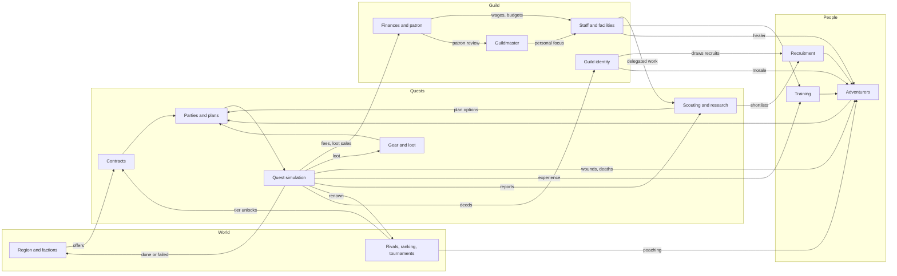

# Plan

Phase 3 plan. Outline approved by the owner on 2026-10-26 (D-062). Each section is drafted in order, with decisions flagged and asked one at a time. Status: §1–§3 written; §4..§15 to do.

Inputs: `docs/design/CONCEPT.md` (locked, D-045), `docs/design/STYLE.md` (locked, D-061), `docs/DECISIONS.md`.

## Part A: Game design

1. **Goals and target player.** Who it's for, session lengths, measurable success criteria. Written below.
2. **Core loop and pacing.** Day, week, season, generation in detail; a friction budget (clicks and stops per in-game week). Written below.
3. **Systems map.** Per system: pillar served, inputs and outputs, the player's real decisions, delegation; a diagram of how systems feed each other. Written below.
4. **Economy and balance.** Money, renown, knowledge: sources and sinks; difficulty curve; tuning targets (e.g. death rate by quest tier).
5. **Progression.** Adventurers, guild and guildmaster, from first recruit to the next generation.
6. **Onboarding, UX and accessibility.** The gentle first season, screen rules, colour-blind, keyboard and text-size support.
7. **Launch content list.** Classes, ancestries, monsters, quest templates, sites; all as data.
8. **Making consequences visible.** How every outcome reaches the player (log lines, letters, inspector fields).
9. **Risks and prototypes.** Riskiest assumptions and the cheapest test for each (quest simulation fun to watch? desk holds FM density? old-press ledgers readable?).
10. **Playtest and metrics plan.**

## Part B: Production

11. **Technology and architecture.** Engine choice, deterministic simulation package, data formats, saves, modding, optional AI flavour.
12. **Art and audio production.** What an artist makes vs what is generated, with costs.
13. **Milestones.** Prototype, vertical slice, alpha, free demo, beta, launch, post-launch roadmap (painted portraits, standee animations, bardic songs, war campaigns).
14. **Budget, team and business assumptions.**
15. **Quality, CI and release process.**

---

## 1. Goals and target player (Accepted 2026-10-26)

Numbers are targets, not measurements (REP-01). Decisions: D-063..D-065.

### 1a. Design goals (Accepted 2026-10-26, D-065)

The game succeeds as a design when a player:

1. Tells a story about one of their adventurers to someone else (Pillar 1).
2. Hesitates before sending a party out, because the risk is real and the people matter (Pillar 2).
3. Plays past their first guildmaster's retirement or dismissal and keeps going with the same guild (Pillar 3).
4. Notices the region changed because of a contract they took or refused (Pillar 4).
5. Hands a system to staff and later takes it back because they wanted to do it better themselves (Pillar 5).

### 1b. Target player (Accepted 2026-10-26, D-063)

- **Primary:** management-sim veterans who already like depth and spreadsheets: Football Manager, Battle Brothers, Darkest Dungeon, RimWorld, Crusader Kings players with a taste for fantasy. They accept dense screens (D-016, CONCEPT §13) and learn by playing, not by tutorial.
- **Secondary:** tabletop RPG players (Pathfinder, D&D) who know classes and parties but are new to management sims. They need the gentle first season (CONCEPT §19) and delegation to carry them.
- **Not targeted:** players who want to control fights directly, or who want a short session-based roguelite. Both are served better by other games, and chasing them would pull against D-003 and the generational save.
- Why the primary is management veterans: the concept (FM-level depth, Ironman saves, a desk-only guildmaster) is built for them; designing for them first and onboarding the secondary group is cheaper than diluting depth.

### 1c. Session lengths (Accepted 2026-10-26, D-064)

The anchor is **one in-game season ≈ 2–2.5 h** for a typical player (owner's choice). Other figures follow from it and from CONCEPT §4; all are targets to measure in playtests (§10). Weeks per season are set in §2.

- **Adventurer career** (6–12 seasons): about 12–30 h.
- **Guildmaster career** (20–30 seasons): about 40–75 h, so most committed players see at least one succession (Pillar 3).
- **Short session:** 20–30 min. Quitting is safe at any point because of the daily autosave (D-033, CONCEPT §29).
- **Typical session:** 1–2 h, ending at a natural stop (a quest's end, a week report).
- **Long session:** 3 h or more, more than a season.
- **First season:** about 3–4 h for a new player, including onboarding.
- Delegation (CONCEPT §19) and time-skip (CONCEPT §4) let fast players go quicker; neither is assumed in these figures.

### 1d. Success criteria (Accepted 2026-10-26, D-065)

Accepted 2026-10-26 as a starting set (D-065); numbers are estimates, revisited in §10 and §14. Measured after release from opt-in, offline-friendly telemetry or store data (method decided in §10):

- **Demo:** at least 15% of demo players who finish the free seasons buy the game.
- **First season:** at least 70% of new saves finish their first season.
- **Retention:** median playtime of buyers over 20 h.
- **Pillar 3 check:** at least 25% of players with over 40 h reach a second guildmaster.
- **Reception:** Steam reviews at least 80% positive ("Very Positive" band).
- **Readability:** in playtests, no dense screen (roster, finances, scouting) needs more than one explanation per player (ties to STYLE §5 risk).

---

## 2. Core loop and pacing (Accepted 2026-10-26)

Decisions: D-066..D-068. All times are targets for a typical player in a mid-sized guild (2–4 parties), to be measured in the prototype (§9) and playtests (§10).

### 2a. Units of time (Accepted 2026-10-26, D-066, D-067)

- **Season = one in-game year**, opened by the Guild Assembly (D-039). Plays in about 2–2.5 h (D-064).
- **Calendar:** 12 months of 4 weeks of 7 days = 48 weeks, 336 days. Month and day names come from the setting (STYLE §9a); the engine only needs the counts.
- **Quest length:** about 2–4 weeks including travel, so a party runs about 8–12 quests a year.

### 2b. The year (Accepted 2026-10-26, D-067)

| Part | Weeks | What happens | Target time |
|---|---|---|---|
| Assembly and muster (spring) | 1–4 | Rankings, promotion and relegation, patron review; recruitment window opens; contract renewals; new contract board. | ~30 min |
| Campaigning (spring–autumn) | 5–36 | Main contract season. Midsummer fair (about weeks 20–21): short second recruitment window and the main tournament. | ~95 min |
| Winter | 37–48 | Slow travel, few contracts; healing, training, academy, building; the odd winter raid. | ~15 min |
| Year's end | — | Chronicle entry, ageing, retirements, the year in review. | ~5 min |

### 2c. The day (Accepted 2026-10-26, D-068)

- Continue advances day by day and only stops for a reason (D-009). A day with no stop passes in under a second, so most days are never seen.
- All stops on the same day are bundled into one stop; the top bar names the reason (STYLE §3).
- Every stop has a sensible default answer, so resolving a routine stop takes 1–3 clicks.

### 2d. The week (Accepted 2026-10-26, D-068)

- **Week report** on the first day of each campaigning week: one letter on the desk summarising last week (results, injuries, money, morale changes) and this week's contract board.
- **Routine week:** take or decline contracts, send a party with its saved plan, continue. Target: 10 clicks or fewer and about 1.5 min.
- **Parties out:** the player watches one party live on the board; the others are summary cards (D-032). Watching is optional and can be sped up or skipped; the result is the same either way (GAME-02).
- With contracts delegated (CONCEPT §19) the week report becomes a digest and need not stop at all, except that choosing contracts is never delegated (D-038), so the board stops whenever there is a new contract worth a decision.

### 2e. The generation (Accepted 2026-10-26, D-068)

- **Adventurers:** careers of 6–12 years (D-034), so about 10–20% of a roster leaves each year through death, retirement or departure. Each year needs fresh recruits to hold strength.
- **Guildmaster:** 20–30 years (about 40–75 h). Decline shows in their stats over the last few years; retirement or dismissal triggers succession (CONCEPT §1, §22).
- **Succession:** a set piece at year's end: choose the next guildmaster (a senior staff member, a retired adventurer, or a newcomer with a background), who inherits the charter, traits and debts. Target: about 10 min.

### 2f. Friction budget (Accepted 2026-10-26, D-068)

Per year, for a typical mid-sized guild:

| Part | Stops | Time per stop | Time |
|---|---|---|---|
| Assembly and muster | ~15 | ~2 min | ~30 min |
| Campaigning, routine (week reports) | ~32 | ~1.5 min | ~48 min |
| Campaigning, events (key moments, people, offers) | ~25 | ~1.9 min | ~47 min |
| Winter | ~8 | ~2 min | ~15 min |
| Year's end | ~2 | ~2.5 min | ~5 min |
| **Total** | **~80** | | **~145 min** |

Rules that keep it there:

1. **Three stop classes.** *Must stop:* major key moments (a life at risk, a moral choice, a large reward), offers with a deadline, departures, big conversations. *Digest:* minor reports and people issues go into the next week report. *Never stop:* minor quest moments, resolved by the party leader (D-032).
2. **Player tunes the classes** per category (like FM's inbox settings), except that never-delegated items (D-038) always stop.
3. **Rate cap:** at most one event stop per day; at most about 3 event stops per week on average. When the simulation produces more, the cap moves only Digest-class items into the digest, lowest priority first; Must-stop items always stop, even past the cap.
4. **Time-skip** (D-034) is offered whenever no party is out and nothing has a deadline; winter defaults to it.
5. **Measure it:** the prototype logs stops per year and seconds per stop; §10 sets the playtest checks.

---

## 3. Systems map (Accepted 2026-10-26)

Decisions: D-069, D-070. This section names each system and how it connects; numbers and formulas belong to §4 (economy) and §5 (progression).

### 3a. Guild resources (Accepted 2026-10-26, D-070)

What systems trade in. Each has one home (SRC-01):

- **Money:** the guild's coin. Contracts, loot sales and patron grants in; wages, upkeep, gear, facilities and loans out (§4).
- **Renown:** the guild's public fame. Earned by deeds; drives the ranking, who wants to join and which contracts are offered (see 3d).
- **Faction standing:** one value per faction (D-019). Moves with contracts taken, refused and failed; the patron is one faction (D-036).
- **Knowledge:** per subject (a monster kind, a site, a rival) (D-041). Improves plans and reveals key-moment options.
- **Per adventurer:** morale, fatigue, health, trust in the guildmaster, experience. Not guild resources, but every system reads or writes them.

### 3b. Systems (Accepted 2026-10-26, D-070)

Launch has 14 systems (D-070). Format per system: pillars served · inputs → outputs · the player's real decisions · who it can be delegated to.

**People**

1. **Adventurers** (D-007, D-008, D-021, D-037). Pillars 1, 2. Includes injury, death and recovery (D-070). Inputs: quest results, training, conversations, wages, guild identity, healer and infirmary. Outputs: performance in quests, morale, demands, departures, stories; time out, scars and trauma traits, deaths, revival offers and their price. Decisions: who to keep, what to promise, how to handle a demand or feud, contract terms, rest or rush back, pay for revival or not. Delegation: none for big conversations or revival (D-038); minor morale chats to the deputy; recovery plans to the healer.
2. **Recruitment** (D-013). Pillar 1. Inputs: shortlists from scouting, renown, charter, money, windows (D-067). Outputs: new adventurers, poaching offers both ways, sales. Decisions: whom to sign, whether to poach or sell. Delegation: none for signing (D-038). Launch has three sources; the training academy moves to Early update (D-070).
3. **Training and development** (CONCEPT §5). Pillars 1, 5. Inputs: trainers, training yard, quest experience. Outputs: attribute growth, class levels, talent choices. Decisions: training focus per adventurer, level-up talents. Delegation: head trainer. Academy apprentices join this system in Early update (D-070).

**Quests**

4. **Contracts** (D-011, D-015). Pillars 2, 4. Inputs: region state, faction standing, renown, ranking tier, rumours from the inbox. Outputs: offered work with fee, loot share, deadline and clauses; region changes when work is done or ignored. Decisions: which contracts to take or refuse (never delegated, D-038), terms to push for. Delegation: deputy haggles fees within limits the player sets.
5. **Parties and plans** (D-014). Pillar 2. Inputs: adventurers, chemistry, scouting and research, gear. Outputs: a party and a plan (roles, approach, risk tolerance, retreat thresholds) handed to the simulation. Decisions: who goes, which plan. Delegation: saved plans per party; party leaders pick minor tactics (D-032).
6. **Quest simulation and key moments** (D-004, D-032). Pillar 2. Inputs: party, plan, gear, research, magic (D-028), site from seeded templates (D-030). Outputs: events for the log and board, loot, wounds, deaths, experience, reports, renown, region change. Decisions: major key moments (push on, retreat, spare, spend). Delegation: minor moments to party leaders; full auto-resolve as a setting.
7. **Scouting and research** (D-013, D-041; merged by D-070). Pillars 2, 5. One department (scouts and librarian) and one ledger of what the guild knows about people, sites, monsters and rivals. Inputs: scout staff, library, survivors' reports, quest events. Outputs: shortlists of prospects with attribute ranges that narrow as knowledge grows, better plan options, revealed key-moment choices, rival reports. Decisions: what and whom to scout or research. Delegation: scouts and librarian.
8. **Gear and loot** (D-012). Pillars 1, 2. Inputs: loot, money, armoury. Outputs: kit tiers on adventurers, storied magic items, sale income. Decisions: kit policy, who gets special pieces, sell or keep. Delegation: quartermaster equips to policy; special and storied pieces stay with the player. Commissioning items moves to Early update (D-070).

**Guild**

9. **Finances and patron** (D-011, D-036). Pillar 3. Inputs: all income and costs, patron expectations. Outputs: balance, debt, patron satisfaction, dismissal risk. Decisions: budget split, loans, which patron to court. Delegation: deputy manages routine spending within a budget.
10. **Staff and facilities** (D-011). Pillars 3, 5. Inputs: money, renown (who will work for you). Outputs: staff quality for every delegated area, facility bonuses. Decisions: whom to hire, which facility to build next. Delegation: heads of department are the player's call; the deputy can hire junior staff.
11. **Guild identity** (D-020). Pillar 3. Inputs: charter, the guild's record of deeds. Outputs: earned traits, which recruits and factions are drawn to the guild, morale effects. Decisions: the charter at founding, whether to act against it. Delegation: none.
12. **Guildmaster** (D-003, D-029). Pillar 3. Inputs: background, what the player personally does. Outputs: effectiveness in each area the player handles, ageing, succession. Decisions: where to spend personal focus. Delegation: n/a; this is the player.

**World**

13. **Region and factions** (D-019, D-030). Pillar 4. Inputs: contracts done, refused and ignored; rival guilds' actions; seeded world events. Outputs: new and closed contracts, faction power, road and trade state, threats that spread. Decisions: none directly; the player shapes it through contracts and patron choice.
14. **Rivals, ranking and tournaments** (D-005, D-039, D-069). Pillar 4. Inputs: renown (3d), rival guild simulation. Outputs: tier, promotion and relegation at the Assembly, bigger contracts, poaching pressure, tournament invitations. Decisions: whether to enter a tournament, whom to send. Delegation: none needed.

**Surfaces** (no decisions of their own; covered in §8): calendar and stops (§2), inbox and news (D-043), Chronicle and Hall of Heroes (D-042).

### 3c. How the systems feed each other (Accepted 2026-10-26, D-070)

The spine is **contract → party → quest → results**. Every other system either prepares the party or spends what the quest brings home.

Checks on the map (WS-05), run on the diagram's edges: every system is reached from quest results within two steps, and every system feeds at least one other. No system is bolted on. The thinnest link is tournaments (only renown, money and pride); §4 must give them a reason to matter.

### 3d. Renown and the ranking (Accepted 2026-10-26, D-069)

- **Renown** is one public number, earned by deeds: contracts by tier, named kills, defences held, tournament results.
- Each tier of the ranking is ordered by **renown earned in the past year**. At the Assembly (D-039) the top of each tier is promoted and the bottom relegated.
- Total renown (all years, slowly fading) still shapes who wants to join and which contracts are offered.
- **Later (owner's note):** "Go with 1 but I eventually want to add a layer of intrigue and underhanded dealings that can mix things up a bit." This belongs with the Later tier's intrigue and investigation (D-035). To keep that open, every renown change is stored as an entry with its source and date (a deed, a tournament, a scandal), so a later intrigue layer can add, contest or strip entries without reworking the ranking (GAME-04). What the intrigue layer contains is not decided.

### 3e. Delegation summary (Accepted 2026-10-26, D-070)

| Area | Staff | Never delegated (D-038) |
|---|---|---|
| Scouting and research | Scouts, librarian | Signing |
| Training | Head trainer | — |
| Recovery | Healer | Revival |
| Kit | Quartermaster | Special and storied items |
| Fee haggling, routine spending, minor morale | Deputy | Choosing contracts, big conversations |
| Minor quest moments | Party leaders (D-032) | Major key moments |
