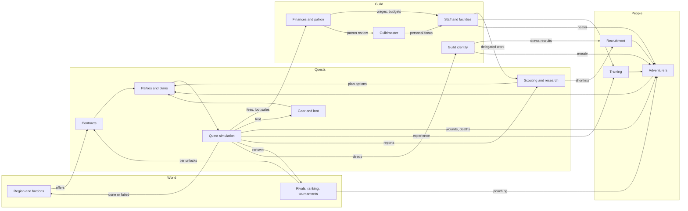
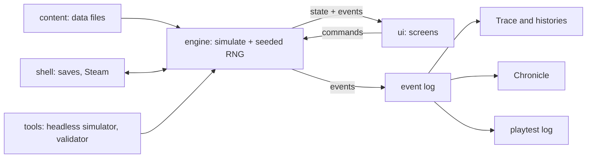

# Plan

Phase 3 plan. Outline approved by the owner on 2026-10-26 (D-062). Each section is drafted in order, with decisions flagged and asked one at a time. Status: Part A (§1–§10) and §11–§13 written; §14 and §15 to do.

Inputs: `docs/design/CONCEPT.md` (locked, D-045), `docs/design/STYLE.md` (locked, D-061), `docs/DECISIONS.md`.

## Part A: Game design

1. **Goals and target player.** Who it's for, session lengths, measurable success criteria. Written below.
2. **Core loop and pacing.** Day, week, season, generation in detail; a friction budget (clicks and stops per in-game week). Written below.
3. **Systems map.** Per system: pillar served, inputs and outputs, the player's real decisions, delegation; a diagram of how systems feed each other. Written below.
4. **Economy and balance.** Money, renown, knowledge: sources and sinks; difficulty curve; tuning targets (e.g. death rate by quest tier). Written below.
5. **Progression.** Adventurers, guild and guildmaster, from first recruit to the next generation. Written below.
6. **Onboarding, UX and accessibility.** The gentle first season, screen rules, colour-blind, keyboard and text-size support. Written below.
7. **Launch content list.** Classes, ancestries, monsters, quest templates, sites; all as data. Written below.
8. **Making consequences visible.** How every outcome reaches the player (log lines, letters, inspector fields). Written below.
9. **Risks and prototypes.** Riskiest assumptions and the cheapest test for each (quest simulation fun to watch? desk holds FM density? old-press ledgers readable?). Written below.
10. **Playtest and metrics plan.** Written below.

## Part B: Production

11. **Technology and architecture.** Engine choice, deterministic simulation package, data formats, saves, modding, optional AI flavour. Written below.
12. **Art and audio production.** What an artist makes vs what is generated, with costs. Written below.
13. **Milestones.** Prototype, vertical slice, alpha, free demo, beta, launch, post-launch roadmap (painted portraits, standee animations, bardic songs, war campaigns). Written below.
14. **Budget, team and business assumptions.**
15. **Quality, CI and release process.**

---

## 1. Goals and target player (Accepted 2026-10-26)

Numbers are targets, not measurements (REP-01). Decisions: D-063..D-065.

### 1a. Design goals (Accepted 2026-10-26, D-065)

The game succeeds as a design when a player:

1. Tells a story about one of their adventurers to someone else (Pillar 1).
2. Hesitates before sending a party out, because the risk is real and the people matter (Pillar 2).
3. Plays past their first guildmaster's retirement or dismissal and keeps going with the same guild (Pillar 3).
4. Notices the region changed because of a contract they took or refused (Pillar 4).
5. Hands a system to staff and later takes it back because they wanted to do it better themselves (Pillar 5).

**Launch feature goal (owner, 2026-10-26, D-087):** a **kingdom map** of the March in a striking, on-theme fantasy style that shows its areas and locations, the guilds, what is happening now and the deeds done there. It builds on the home-screen region map (D-049, STYLE §3). Owner: "We can workshop that later but I'd like something like that at launch." Details to workshop with the art work (§12).

### 1b. Target player (Accepted 2026-10-26, D-063)

- **Primary:** management-sim veterans who already like depth and spreadsheets: Football Manager, Battle Brothers, Darkest Dungeon, RimWorld, Crusader Kings players with a taste for fantasy. They accept dense screens (D-016, CONCEPT §13) and learn by playing, not by tutorial.
- **Secondary:** tabletop RPG players (Pathfinder, D&D) who know classes and parties but are new to management sims. They need the gentle first season (CONCEPT §19) and delegation to carry them.
- **Not targeted:** players who want to control fights directly, or who want a short session-based roguelite. Both are served better by other games, and chasing them would pull against D-003 and the generational save.
- Why the primary is management veterans: the concept (FM-level depth, Ironman saves, a desk-only guildmaster) is built for them; designing for them first and onboarding the secondary group is cheaper than diluting depth.

### 1c. Session lengths (Accepted 2026-10-26, D-064)

The anchor is **one in-game season ≈ 2–2.5 h** for a typical player (owner's choice). Other figures follow from it and from CONCEPT §4; all are targets to measure in playtests (§10). Weeks per season are set in §2.

- **Adventurer career** (6–12 seasons): about 12–30 h.
- **Guildmaster career** (20–30 seasons): about 40–75 h, so most committed players see at least one succession (Pillar 3).
- **Short session:** 20–30 min. Quitting is safe at any point because of the daily autosave (D-033, CONCEPT §29).
- **Typical session:** 1–2 h, ending at a natural stop (a quest's end, a week report).
- **Long session:** 3 h or more, more than a season.
- **First season:** about 3–4 h for a new player, including onboarding.
- Delegation (CONCEPT §19) and time-skip (CONCEPT §4) let fast players go quicker; neither is assumed in these figures.

### 1d. Success criteria (Accepted 2026-10-26, D-065)

Accepted 2026-10-26 as a starting set (D-065); numbers are estimates, revisited in §10 and §14. Measured after release from opt-in, offline-friendly telemetry or store data (method decided in §10):

- **Demo:** at least 15% of demo players who finish the free seasons buy the game.
- **First season:** at least 70% of new saves finish their first season.
- **Retention:** median playtime of buyers over 20 h.
- **Pillar 3 check:** at least 25% of players with over 40 h reach a second guildmaster.
- **Reception:** Steam reviews at least 80% positive ("Very Positive" band).
- **Readability:** in playtests, no dense screen (roster, finances, scouting) needs more than one explanation per player (ties to STYLE §5 risk).

---

## 2. Core loop and pacing (Accepted 2026-10-26)

Decisions: D-066..D-068. All times are targets for a typical player in a mid-sized guild (2–4 parties), to be measured in the prototype (§9) and playtests (§10).

### 2a. Units of time (Accepted 2026-10-26, D-066, D-067)

- **Season = one in-game year**, opened by the Guild Assembly (D-039). Plays in about 2–2.5 h (D-064).
- **Calendar:** 12 months of 4 weeks of 7 days = 48 weeks, 336 days. Month and day names come from the setting (STYLE §9a); the engine only needs the counts.
- **Quest length:** about 2–4 weeks including travel, so a party runs about 8–12 quests a year.

### 2b. The year (Accepted 2026-10-26, D-067)

| Part | Weeks | What happens | Target time |
|---|---|---|---|
| Assembly and muster (spring) | 1–4 | Rankings, promotion and relegation, patron review; recruitment window opens; contract renewals; new contract board. | ~30 min |
| Campaigning (spring–autumn) | 5–36 | Main contract season. Midsummer fair (about weeks 20–21): short second recruitment window and the main tournament. | ~95 min |
| Winter | 37–48 | Slow travel, few contracts; healing, training, academy, building; the odd winter raid. | ~15 min |
| Year's end | — | Chronicle entry, ageing, retirements, the year in review. | ~5 min |

### 2c. The day (Accepted 2026-10-26, D-068)

- Continue advances day by day and only stops for a reason (D-009). A day with no stop passes in under a second, so most days are never seen.
- All stops on the same day are bundled into one stop; the top bar names the reason (STYLE §3).
- Every stop has a sensible default answer, so resolving a routine stop takes 1–3 clicks.

### 2d. The week (Accepted 2026-10-26, D-068)

- **Week report** on the first day of each campaigning week: one letter on the desk summarising last week (results, injuries, money, morale changes) and this week's contract board.
- **Routine week:** take or decline contracts, send a party with its saved plan, continue. Target: 10 clicks or fewer and about 1.5 min.
- **Parties out:** the player watches one party live on the board; the others are summary cards (D-032). Watching is optional and can be sped up or skipped; the result is the same either way (GAME-02).
- With contracts delegated (CONCEPT §19) the week report becomes a digest and need not stop at all, except that choosing contracts is never delegated (D-038), so the board stops whenever there is a new contract worth a decision.

### 2e. The generation (Accepted 2026-10-26, D-068)

- **Adventurers:** survivors' careers last 6–12 years (D-034), but about half of careers end in death (D-071), so about 25% of a roster leaves each year through death, retirement or departure. A mid-sized guild needs about 4 recruits a year to hold strength.
- **Guildmaster:** 20–30 years (about 40–75 h). Decline shows in their stats over the last few years; retirement or dismissal triggers succession (CONCEPT §1, §22).
- **Succession:** a set piece at year's end: choose the next guildmaster (a senior staff member, a retired adventurer, or a newcomer with a background), who inherits the charter, traits and debts. Target: about 10 min.

### 2f. Friction budget (Accepted 2026-10-26, D-068)

Per year, for a typical mid-sized guild:

| Part | Stops | Time per stop | Time |
|---|---|---|---|
| Assembly and muster | ~15 | ~2 min | ~30 min |
| Campaigning, routine (week reports) | ~32 | ~1.5 min | ~48 min |
| Campaigning, events (key moments, people, offers) | ~25 | ~1.9 min | ~47 min |
| Winter | ~8 | ~2 min | ~15 min |
| Year's end | ~2 | ~2.5 min | ~5 min |
| **Total** | **~80** | | **~145 min** |

Rules that keep it there:

1. **Three stop classes.** *Must stop:* major key moments (a life at risk, a moral choice, a large reward), offers with a deadline, departures, big conversations. *Digest:* minor reports and people issues go into the next week report. *Never stop:* minor quest moments, resolved by the party leader (D-032).
2. **Player tunes the classes** per category (like FM's inbox settings), except that never-delegated items (D-038) always stop.
3. **Rate cap:** at most one event stop per day; at most about 3 event stops per week on average. When the simulation produces more, the cap moves only Digest-class items into the digest, lowest priority first; Must-stop items always stop, even past the cap.
4. **Time-skip** (D-034) is offered whenever no party is out and nothing has a deadline; winter defaults to it.
5. **Measure it:** the prototype logs stops per year and seconds per stop; §10 sets the playtest checks.

---

## 3. Systems map (Accepted 2026-10-26)

Decisions: D-069, D-070. This section names each system and how it connects; numbers and formulas belong to §4 (economy) and §5 (progression).

### 3a. Guild resources (Accepted 2026-10-26, D-070)

What systems trade in. Each has one home (SRC-01):

- **Money:** the guild's coin. Contracts, loot sales and patron grants in; wages, upkeep, gear, facilities and loans out (§4).
- **Renown:** the guild's public fame. Earned by deeds; drives the ranking, who wants to join and which contracts are offered (see 3d).
- **Faction standing:** one value per faction (D-019). Moves with contracts taken, refused and failed; the patron is one faction (D-036).
- **Knowledge:** per subject (a monster kind, a site, a rival) (D-041). Improves plans and reveals key-moment options.
- **Per adventurer:** morale, fatigue, health, trust in the guildmaster, experience. Not guild resources, but every system reads or writes them.

### 3b. Systems (Accepted 2026-10-26, D-070)

Launch has 14 systems (D-070). Format per system: pillars served · inputs → outputs · the player's real decisions · who it can be delegated to.

**People**

1. **Adventurers** (D-007, D-008, D-021, D-037). Pillars 1, 2. Includes injury, death and recovery (D-070). Inputs: quest results, training, conversations, wages, guild identity, healer and infirmary. Outputs: performance in quests, morale, demands, departures, stories; time out, scars and trauma traits, deaths, revival offers and their price. Decisions: who to keep, what to promise, how to handle a demand or feud, contract terms, rest or rush back, pay for revival or not. Delegation: none for big conversations or revival (D-038); minor morale chats to the deputy; recovery plans to the healer.
2. **Recruitment** (D-013). Pillar 1. Inputs: shortlists from scouting, renown, charter, money, windows (D-067). Outputs: new adventurers, poaching offers both ways, sales. Decisions: whom to sign, whether to poach or sell. Delegation: none for signing (D-038). Launch has three sources; the training academy moves to Early update (D-070).
3. **Training and development** (CONCEPT §5). Pillars 1, 5. Inputs: trainers, training yard, quest experience. Outputs: attribute growth, class levels, talent choices. Decisions: training focus per adventurer, level-up talents. Delegation: head trainer. Academy apprentices join this system in Early update (D-070).

**Quests**

4. **Contracts** (D-011, D-015). Pillars 2, 4. Inputs: region state, faction standing, renown, ranking tier, rumours from the inbox. Outputs: offered work with fee, loot share, deadline and clauses; region changes when work is done or ignored. Decisions: which contracts to take or refuse (never delegated, D-038), terms to push for. Delegation: deputy haggles fees within limits the player sets.
5. **Parties and plans** (D-014). Pillar 2. Inputs: adventurers, chemistry, scouting and research, gear. Outputs: a party and a plan (roles, approach, risk tolerance, retreat thresholds) handed to the simulation. Decisions: who goes, which plan. Delegation: saved plans per party; party leaders pick minor tactics (D-032).
6. **Quest simulation and key moments** (D-004, D-032). Pillar 2. Inputs: party, plan, gear, research, magic (D-028), site from seeded templates (D-030). Outputs: events for the log and board, loot, wounds, deaths, experience, reports, renown, region change. Decisions: major key moments (push on, retreat, spare, spend). Delegation: minor moments to party leaders; full auto-resolve as a setting.
7. **Scouting and research** (D-013, D-041; merged by D-070). Pillars 2, 5. One department (scouts and librarian) and one ledger of what the guild knows about people, sites, monsters and rivals. Inputs: scout staff, library, survivors' reports, quest events. Outputs: shortlists of prospects with attribute ranges that narrow as knowledge grows, better plan options, revealed key-moment choices, rival reports. Decisions: what and whom to scout or research. Delegation: scouts and librarian.
8. **Gear and loot** (D-012). Pillars 1, 2. Inputs: loot, money, armoury. Outputs: kit tiers on adventurers, storied magic items, sale income. Decisions: kit policy, who gets special pieces, sell or keep. Delegation: quartermaster equips to policy; special and storied pieces stay with the player. Commissioning items moves to Early update (D-070).

**Guild**

9. **Finances and patron** (D-011, D-036). Pillar 3. Inputs: all income and costs, patron expectations. Outputs: balance, debt, patron satisfaction, dismissal risk. Decisions: budget split, loans, which patron to court. Delegation: deputy manages routine spending within a budget.
10. **Staff and facilities** (D-011). Pillars 3, 5. Inputs: money, renown (who will work for you). Outputs: staff quality for every delegated area, facility bonuses. Decisions: whom to hire, which facility to build next. Delegation: heads of department are the player's call; the deputy can hire junior staff.
11. **Guild identity** (D-020). Pillar 3. Inputs: charter, the guild's record of deeds. Outputs: earned traits, which recruits and factions are drawn to the guild, morale effects. Decisions: the charter at founding, whether to act against it. Delegation: none.
12. **Guildmaster** (D-003, D-029). Pillar 3. Inputs: background, what the player personally does. Outputs: effectiveness in each area the player handles, ageing, succession. Decisions: where to spend personal focus. Delegation: n/a; this is the player.

**World**

13. **Region and factions** (D-019, D-030). Pillar 4. Inputs: contracts done, refused and ignored; rival guilds' actions; seeded world events. Outputs: new and closed contracts, faction power, road and trade state, threats that spread. Decisions: none directly; the player shapes it through contracts and patron choice.
14. **Rivals, ranking and tournaments** (D-005, D-039, D-069). Pillar 4. Inputs: renown (3d), rival guild simulation. Outputs: tier, promotion and relegation at the Assembly, bigger contracts, poaching pressure, tournament invitations. Decisions: whether to enter a tournament, whom to send. Delegation: none needed.

**Surfaces** (no decisions of their own; covered in §8): calendar and stops (§2), inbox and news (D-043), Chronicle and Hall of Heroes (D-042).

### 3c. How the systems feed each other (Accepted 2026-10-26, D-070)

The spine is **contract → party → quest → results**. Every other system either prepares the party or spends what the quest brings home.

Checks on the map (WS-05), run on the diagram's edges: every system is reached from quest results within two steps, and every system feeds at least one other. No system is bolted on. The thinnest link is tournaments (only renown, money and pride); §4 must give them a reason to matter.

### 3d. Renown and the ranking (Accepted 2026-10-26, D-069)

- **Renown** is one public number, earned by deeds: contracts by tier, named kills, defences held, tournament results.
- Each tier of the ranking is ordered by **renown earned in the past year**. At the Assembly (D-039) the top of each tier is promoted and the bottom relegated.
- Total renown (all years, slowly fading) still shapes who wants to join and which contracts are offered.
- **Later (owner's note):** "Go with 1 but I eventually want to add a layer of intrigue and underhanded dealings that can mix things up a bit." This belongs with the Later tier's intrigue and investigation (D-035). To keep that open, every renown change is stored as an entry with its source and date (a deed, a tournament, a scandal), so a later intrigue layer can add, contest or strip entries without reworking the ranking (GAME-04). What the intrigue layer contains is not decided.

### 3e. Delegation summary (Accepted 2026-10-26, D-070)

| Area | Staff | Never delegated (D-038) |
|---|---|---|
| Scouting and research | Scouts, librarian | Signing |
| Training | Head trainer | — |
| Recovery | Healer | Revival |
| Kit | Quartermaster | Special and storied items |
| Fee haggling, routine spending, minor morale | Deputy | Choosing contracts, big conversations |
| Minor quest moments | Party leaders (D-032) | Major key moments |

---

## 4. Economy and balance (Accepted 2026-10-26)

Decisions: D-071..D-073. This section sets shapes, ratios and targets; exact numbers are tuned in the prototype (§9) against these targets. "Mid-sized guild" means about 15 adventurers in 3 parties.

### 4a. Sources and sinks (Accepted 2026-10-26, D-073)

| Resource | Sources | Sinks |
|---|---|---|
| Money | Contract fees, loot sales, patron grant, tournament prizes, selling adventurers' contracts | Wages (the largest cost), staff, upkeep, gear, facilities, revival, loan interest, release fees |
| Renown | Contracts by danger, named kills, defences held, tournament results, storied items | Yearly fading of total renown, failed or abandoned contracts, deaths through recklessness (a party sent far above its level), breaking the charter, later: scandals (D-069) |
| Faction standing | Contracts for a faction, defending its land, patronage | Contracts against its interests, refusing its work, failing it, serving its enemies |
| Knowledge | Scouting, library research, survivors' reports (even from failed quests), quest events | Goes stale: monster and site knowledge fades slowly, rival knowledge fast (rosters change) |

Rules:
1. **Every source has a sink.** Nothing accumulates without limit; late-game money goes into facilities, stars' wages and revival, not a growing pile.
2. **Failure pays in knowledge.** A failed quest's survivors bring back reports, so a loss always leaves the guild better informed (Pillars 2, 5).
3. **Rivals play by the same rules.** AI guilds earn, spend, recruit and die through the same simulation (GAME-02); no hidden bonuses or rubber-banding.

### 4b. Money pressure (Accepted 2026-10-26, D-072)

**Tight early, steady later**, as in FM.

- **Wages** are the largest cost: about 55–65% of spending at every tier.
- **A founded guild** starts with about 3 months of running costs in the chest plus a small patron grant. One bad run of contracts hurts; two in a row means a loan or a sale.
- **A well-run mid-tier guild** is comfortable: about 10–20% surplus a year, spent on facilities and better recruits.
- **A top guild** feels pressure again: stars ask for big wages and loot cuts, rivals bid for them, and the patron expects more.
- **Bankruptcy** follows CONCEPT §22: debt, seized assets and a renown hit, not the end.
- **Contract fees** rise about 2–3 times per danger rating and per ranking tier (to be tuned, §9).

### 4c. Death and danger (Accepted 2026-10-26, D-071)

**Target: about 2 deaths a year** in a mid-sized guild on tier-appropriate contracts at default risk: one death every 1–1.5 h of play, about half of careers ending in death, turnover about 25% a year (about 4 recruits a year).

Contracts carry a danger rating. Working names: **Routine, Hazardous, Perilous, Deadly** (final names per STYLE §9). Starting targets per adventurer per quest, at default risk with no special knowledge:

| Danger | Share of a mid guild's work | Death per adventurer | Any death in a party of 5 |
|---|---|---|---|
| Routine | ~30% | 0.2% | ~1% |
| Hazardous | ~40% | 0.8% | ~4% |
| Perilous | ~25% | 2.5% | ~12% |
| Deadly | ~5% | 7% | ~30% |

Check (computed): 3 parties × ~10 quests × 5 adventurers = 150 adventurer-quests a year at a 1.36% average gives about 2.0 deaths a year.

- The plan moves these numbers: cautious retreat thresholds and good knowledge roughly halve them; reckless settings roughly double them (to be tuned, §9).
- Injuries are far more common than deaths: as a starting target, about 5 lasting injuries for every death.
- Rough model behind the choice (estimate, not measured; survivors retire after about 9 years):

| Deaths a year | Leavers a year | Turnover | Careers ending in death | Play time per death |
|---|---|---|---|---|
| ~1 | ~2.7 | ~18% | ~37% | ~2.2 h |
| ~2.5 | ~4.2 | ~28% | ~60% | ~0.9 h |
| ~5 | ~6.7 | ~44% | ~75% | ~0.5 h |

### 4d. Tournaments: why they matter (Accepted 2026-10-26, D-073)

§3c flagged tournaments as the thinnest link. Proposal: tournaments are the guild's **shop window**.

- **Renown burst:** a tournament win is worth about a month of good contracts in renown, in one week.
- **Recruitment draw:** prospects watch. A strong showing improves the next recruitment window (more and better prospects interested).
- **Scouting rivals:** entering reveals knowledge of rival adventurers who compete, and exposes yours to poaching interest in return.
- **Low lethality:** trials and cups are rarely deadly, so they are where young adventurers get experience and nerves are tested in front of a crowd; the main tournament prize is often a storied item.
- **Cost:** a party entered is a party not on contracts for 1–2 weeks at the busiest time of year (midsummer).

### 4e. Difficulty curve (Accepted 2026-10-26, D-073)

- **Start choice sets difficulty** (D-026): founding (tiny roster, bottom tier, low expectations) or taking over a guild from a list that runs from a struggling bottom-tier hall to an established top guild with a demanding patron. No separate difficulty slider at launch.
- **Ladder:** 3 tiers of 6 guilds (18 guilds in the region, including the player's). At each Assembly the top 1 of a tier goes up and the bottom 1 goes down; top tiers get bigger, deadlier and better-paid contracts. The number of tiers and guilds is region data (GAME-04). Owner's note: "1 but bigger ladders later": larger ladders come after launch (tier and size not set). Estimate: a well-run founded guild reaches the middle tier in 3–5 years and the top in 8–12.
- **Danger tracks ambition:** the player always chooses contracts (D-038), so difficulty within a tier is the player's own risk appetite.
- **Early protection:** the first season (gentle onboarding, CONCEPT §19) offers mostly Routine and Hazardous work and the patron expects little.
- **Late pressure:** a top guild faces rivals poaching its stars, high wages, a demanding patron and Deadly contracts; staying on top is harder than getting there (as in FM).

### 4f. Tuning targets (Accepted 2026-10-26, D-073)

Measured in the prototype and playtests (§9, §10). All are estimates until then:

- Death rate per adventurer per quest by danger rating: §4c.
- Money: wages 55–65% of spending; founded guild runway about 3 months; well-run mid guild 10–20% surplus a year (§4b).
- Ranking: a well-run founded guild promoted within 3–5 years; a careless top guild relegated within 2–3.
- Renown: total renown fades about 10% a year, so a guild that stops performing slides within a few years.
- Knowledge: a monster kind well researched stays useful for about 3–5 years; a rival scouting report for about 1 year.
- Tournaments: entering is worth it for a mid-sized guild about once a year, not every time.

---

## 5. Progression (Accepted 2026-10-26)

Decisions: D-074, D-075. Shapes and targets only; exact curves are tuned in the prototype (§9). Times assume one season = one year (D-066) and survivors' careers of 6–12 years (D-034).

### 5a. Adventurers: the four layers over a career (Accepted 2026-10-26, D-075)

The four layers (D-037) grow at different speeds, so every year shows some change:

- **Attributes (1–20)** grow through training and quests toward a hidden potential (CONCEPT §5), fastest in the first 3–4 years. They peak in the adventurer's prime and decline with age and lasting injuries; physical attributes fall first, mental ones last. Ancestry sets the ages (a long-lived ancestry peaks later and declines slower), as data (GAME-04).
- **Class levels** (Accepted 2026-10-26, D-074): **10 levels at launch**, the main visible sign of growth. Each level adds class abilities and one talent pick. Pace: about 1 level a year early in a career, slowing later; most survivors retire around level 7–9; level 10 marks a legend. Multiclassing or a prestige path opens at level 5.
  - **Planned: 20 levels later** (owner's note: "Start with 10. Plan for 20 eventually"). To keep that open, the level count, experience curve and per-level abilities are class data (GAME-04), and level-gated rules (prestige at 5, danger ratings) refer to bands, not fixed numbers. Going to 20 later needs its own pacing decision (faster levelling or longer careers) and twice the per-class content.
- **Talents** are chosen at each level: the player picks, or the head trainer picks to a plan (D-070 delegation). Multiclassing or a prestige path opens at a set level (CONCEPT §15).
- **Traits** change through events, not training: scars and trauma from injuries (D-008), deeds ("Survived the Fen Drake"), habits and personality shifts. They are the layer that carries the adventurer's story.

**Shape of a career** (targets): years 1–3 rapid growth; years 4–8 prime, most dangerous work; years 9+ decline, the choice between retiring them, keeping them as a mentor in a quieter role, or one last contract.

### 5b. Adventurers: the end of a career (Accepted 2026-10-26, D-075)

- **Retirement** is a conversation (D-038): the adventurer asks, or the player suggests it. Refusing a request costs morale; pushing someone out costs trust among their friends.
- **Retired adventurers can become staff** (trainer, scout, healer or quartermaster, by attributes and class), limited by their attributes and by staff wages. This turns the old generation into the guild's teachers (Pillar 3) and gives a reason to keep veterans alive. They age out of staff work in turn.
- **Death** goes to the Chronicle and Hall of Heroes (D-042); friends and rivals react (D-021).
- **Revival** (D-008) costs lost levels or traits and a debt, so a revived veteran comes back changed, not restored.

### 5c. The guild (Accepted 2026-10-26, D-075)

The guild grows on four tracks, each visible on the desk:

- **Ranking tier** (D-069, D-073): the public ladder.
- **Facilities:** training yard, infirmary, library, armoury, tavern (CONCEPT §9), each with **3 levels**. Each level is a real choice of money and time (a build takes weeks, done best in winter, D-067). A full set of level-3 facilities costs about 8–12 years of a mid guild's surplus (estimate), so the player chooses what to specialise in. Owner's note: "plan on eventually having those grow to larger numbers or break the facilities into smaller portions kind of city building style on that you have buildings you can build and upgrade as part of your guild hall / compound." Later (tier not set): more facility levels, or a guild compound of separate buildings to place, build and upgrade. To keep that open, each facility is a building entry in data with its own levels and effects (GAME-04), and the guildhall screen draws from that list rather than five fixed slots.
- **Earned traits** (D-020): granted by what the guild repeatedly does, not by one event, and lost when it stops. At most **5 active** at once, so they describe the guild as it is now; old ones go to the Chronicle.
- **Renown and the Chronicle** (D-042): the guild's history grows every year whatever the result.

### 5d. The guildmaster (Accepted 2026-10-26, D-075)

- **Stats (1–20):** about 8, covering what the player can do personally: judging ability, judging potential, negotiation, motivation, people management (morale and promises), tactics (plans and key moments), coaching, and contacts. Final list in §7 content data.
- **Background** (D-029) sets starting stats and contacts.
- **Growth by doing** (D-029): each stat grows when the player personally does that work and stays still when it is delegated. Target: a focused stat gains about 1 point a year early in a career, slowing toward a cap set by the background.
- **Ageing:** a guildmaster starts at about 30–45; stats begin to decline in the last 3–5 years of a 20–30 year career (D-034); the patron or the guildmaster's health ends it.

### 5e. The next generation (Accepted 2026-10-26, D-075)

- **Succession** (D-068 set piece): the heir is chosen from senior staff, retired adventurers who became staff, or a newcomer with a background. An heir who was an adventurer brings their own history and contacts.
- **What passes on:** guild, charter, traits, facilities, roster, debts, rivalries, faction standing and the Chronicle. **What doesn't:** the old guildmaster's stats and personal contacts; promises the old guildmaster made are remembered, and the new one inherits the trust or resentment.
- **Adventurers react** to the new guildmaster: some loyal to the old one may leave or test the new one (D-021).
- **Later (Early update, D-070):** the academy adds a home-grown line, including the children of guild heroes.

---

## 6. Onboarding, UX and accessibility (Accepted 2026-10-26)

Decisions: D-076..D-078. Mock-ups: `docs/design/mockups/onboarding.html`, `docs/design/mockups/readability.html`.

### 6a. The first season (Accepted 2026-10-26, D-076)

Goal: a new player finishes the first season in about 3–4 h (D-064) and 70% of new saves do (D-065), without slowing down the management-sim veteran (D-063). Mock-up: `docs/design/mockups/onboarding.html`.

Owner's note: "I like a for the first season but I like having a small prologue as an intro to the system and I really like having on theme clerks notes on relevant documents."

1. **A small prologue** (about 10–15 min): the guild's first contract, a small job near home with the starting party, walking through briefing, the board, one key moment and the report. It runs on the real systems with a fixed seed (GAME-01), not a separate script, so it stays correct as systems change. Skippable.
2. **Staff open the ledgers** through the first season: ledgers start sealed and open when they first matter (first injury opens the Infirmary, first wages day opens Finances, first window opens Scouting, first Assembly opens Ranking), each with a short letter from the staff member who runs it. A fallback date opens any ledger whose trigger never fires. A checklist shows what is open and what comes next.
3. **The clerk's notes:** pencilled, in-world notes on relevant documents, the first time a ledger opens and whenever a document has something unusual (a contract with a harsh clause, a prospect seen only once). The player can put them away for good, or per ledger.
4. **Veteran start** (a setting at new game) skips the prologue and opens every ledger on day one; the clerk's notes stay on unless put away.

### 6b. Screen rules (Accepted 2026-10-26, D-078)

1. **Every number explains itself.** Hovering or focusing any number shows how it was made (base, modifiers, sources), in plain words. The engine produces the breakdown (GAME-02); the UI never recomputes it.
2. **One sheet, one job.** Each ledger answers one question (who is fit? what do we owe?); comparisons open side by side instead of in a new mode.
3. **The top bar never moves** (STYLE §3): date, why the calendar stopped, Continue.
4. **Every stop has a default** (D-068) and the default is shown on the button.
5. **Confirm only what can't be undone:** signing and releasing, dismissing staff, revival, sending a party on a Deadly contract. Everything else (plans, kit, training focus) can be changed freely until Continue.
6. **Uncertainty looks uncertain:** scouted attributes show as ranges until known (CONCEPT §10); predictions show odds in words and numbers ("likely, about 70%").
7. **Never colour alone:** every status has an icon or word as well as its colour (D-048).

### 6c. Accessibility (Accepted 2026-10-26, D-078)

- **Colour-blind:** the fixed status set (D-048) is chosen to stay distinct under the three common types; faction colours always carry a heraldic charge as well.
- **Text size and readability (Accepted 2026-10-26, D-077):** a size slider from 100% to 150%, plus a **clear print** setting that switches ledgers and letters to a modern book serif (an open-font-licence face, chosen in UI work); titles, seals and the decorated initial keep the old-press faces. Mock-up: `docs/design/mockups/readability.html`. Corrected 2026-10-26: the first mock-up showed the old-press ledger with its default old-style, proportional figures by mistake. The face has lining figures (measured: equal width, all on the line, via `lining-nums`), and all numbers in the game use them. Minimum size: §9c.
- **Keyboard:** everything playable by keyboard; Space continues; number keys pick stop options; letters jump to ledgers; all bindings can be changed.
- **No time pressure:** the calendar never moves without Continue; reading a letter or a key moment never has a timer.
- **Motion:** board animations and map drawing can be shortened or turned off; nothing important is shown only in motion.
- **Sound:** every sound that carries meaning (the death bell, the key-moment drum, D-055) has a visible counterpart; optional captions for vocal sounds (D-060).
- **Screen readers:** not promised at launch; the UI is built from labelled controls so it can be added later (assumption to check in §11).

---

## 7. Launch content list (Accepted 2026-10-26)

Decisions: D-079..D-081. Every item is a data entry (GAME-04, D-044), so counts can grow after launch without engine work. Names are working names; final names follow STYLE §9a.

### 7a. People (Accepted 2026-10-26, D-079, D-081)

- **Classes: 8** (D-018), one per classic role. Working list: warrior, guardian, rogue, ranger, cleric, wizard, druid, and a bard-like support. Final names and identities are original (D-002).
  - Per class: abilities across 10 levels (D-074); about 15 class talents, plus a shared pool of about 30 general talents.
  - **Prestige paths: 4** at launch, opening at level 5 (D-074); multiclassing between any two classes from level 5.
  - Casters (cleric, wizard, druid, support) draw on limited daily power with risks (D-028); each class's magic is tagged with a tradition slot left empty for later.
- **Ancestries: 5** (Accepted 2026-10-26, D-079): two familiar peoples, two grown from the March, plus humans. Mock-up: `docs/design/mockups/ancestries.html` (option C). Names, ages and hooks are first drafts:
  - **Marchfolk** (humans of the March): learn fastest. Prime about 24–32.
  - **Stonewrights** (stout hill miners): shrug off poison and wounds, slow to heal from trauma. Prime about 40–80.
  - **Lanthe** (long-lived wood folk): grow slowly, can serve under several guildmasters (Pillar 3). Prime about 60–200.
  - **Reedfolk** (fen stilt-dwellers): parties with one travel the fens fast. Prime about 22–34.
  - **Barrowborn** (born near the old barrows): see in the dark, sense the restless dead; the temple faction distrusts them. Prime about 24–32.
  - Each sets attribute leanings, ageing (D-075), naming rules (D-058) and one or two traits. Later as data: Hearthlings (small folk), Grael (tusked clans), Mossbacks, Ashlings.
- **Attributes: about 28** on the 1–20 scale (D-007), including hidden ones (potential, consistency, loyalty). Final list during the prototype (§9).
- **Traits:** about 40 personality traits and about 60 earned traits (scars, trauma, deeds, habits).
- **Staff roles: 6** (deputy, trainer, scout, librarian, healer, quartermaster), each with about 6 role attributes.
- **Guildmaster backgrounds: 5** (ex-adventurer, merchant, noble, scholar, temple-raised).

### 7b. Threats (Accepted 2026-10-26, D-080)

- **Monsters: 36 kinds** (D-080) in 7 families (beasts, the restless dead, fen things, goblin-kind, giants and trolls, cultists and bandits, old magic), each kind with a few variants by danger rating.
- **Named beasts:** generated from monster kinds with a name, a history and a bounty (CONCEPT §12); they remember fights and grow.
- **Bandit and cult groups** for defence work, tied to the outlaw faction.

### 7c. Places and work (Accepted 2026-10-26, D-080)

- **Region:** one authored region, the March (D-030): **8 settlements**, **5 biomes** (fen, downs and woods, moor, hills and caves, coast), about 12 authored landmarks.
- **Factions: 6**: the crown, two cities, a temple, a merchant house and the outlaws (CONCEPT §16), each with a crest, colours and naming rules.
- **Rival guilds: 17** (3 tiers of 6 with the player, D-073), each authored: name, crest, charter, specialty, patron, home town and a few founding adventurers.
- **Site templates** (seeded, D-030): delve sites (barrows, ruins, mines, caves, sunken chapels and so on), beast lairs, and defence sites (village, fort, bridge, mill). **20 templates** (D-080).
- **Quest templates:** delves, hunts, bounties on named beasts, defences, plus the prologue contract (D-076). **20 templates** (D-080).
- **Key-moment templates:** the decisions that stop the calendar (push on, retreat, spare, spend). **60 templates** (D-080), each with several text variants.
- **Tournaments: 3** kinds (guild trials, a monster-hunt cup, an arena event), with the main one at the midsummer fair (D-067).

### 7d. Guild and gear (Accepted 2026-10-26, D-080)

- **Facilities: 5** × 3 levels (D-075).
- **Gear:** 4 tiers × about 10 kit types; about 30 magic-item templates that generate storied items, plus about 10 authored legendary items placed in the region.
- **Guild traits:** about 25 earnable traits (D-020, D-075).
- **Charter options:** values scale, about 8 specialties, about 12 house rules.

### 7e. Writing (Accepted 2026-10-26, D-080)

- Letters, reports, rumours, criers' notices, Chronicle entries and conversation lines, all as templates with many variants (D-059). Target **about 6,000 template lines** (D-080), costed in §12.

---

## 8. Making consequences visible (Accepted 2026-10-26)

Decisions: D-082, D-083. Pillars 2 and 4 only work if the player can see what their choices caused (GAME-04). Mock-up: `docs/design/mockups/consequences.html`.

### 8a. Surfaces (Accepted 2026-10-26, D-083)

Each outcome reaches the player through one or more of these, from immediate to permanent:

| Surface | Carries | When |
|---|---|---|
| Quest log and board (D-004, STYLE §4) | Every simulation event as one line, played on the board | Live |
| Party summary cards (D-032) | Parties not being watched | Live |
| Week report (D-068) | Digest: results, injuries, money, morale moves | Weekly |
| Letters (D-043) | Consequences that need or deserve attention, from a person in the world | When they land |
| Criers and gossip (D-043) | Public news: rankings, rivals' deeds, region changes | When they land |
| Region map (D-049), raised to the kingdom map (D-087, D-097) | Areas and locations, factions, guilds, parties and rivals in action, threats (deeds and rumours on the map later) | Always |
| Inspector fields | Every person, item, place and faction: value, breakdown (D-078) and dated history | On demand |
| Chronicle and Hall of Heroes (D-042) | Deeds, deaths, storied items, records | Permanent |
| Year in review (D-067) | The year's biggest causes and effects | Year's end |

### 8b. Rules (Accepted 2026-10-26, D-083)

1. **No silent change.** Every change to a resource, a person or a place writes at least a log line or an inspector history entry; important ones also send a letter.
2. **Every change records its cause** (the decision or event that started it) and the player can reach that cause in at most 2 clicks. The engine records causes; the UI only shows them (GAME-02).
3. **Delayed consequences name their cause.** A letter about a raid 8 weeks after a refused contract says so.
4. **Importance follows the stop classes** (D-068): must-stop outcomes get a stop and a letter; digest outcomes go to the week report; minor ones go to the log and history only.
5. **Forewarning follows knowledge** (D-041): a spreading threat shows on the map first as a rumour, then sharper as scouts and the library learn more. Nothing important arrives with no warning at all unless the guild chose not to look.
6. **Deaths are never quiet:** the bell (STYLE §8), a memorial letter written sincerely (D-059), friends' and rivals' reactions, a Chronicle entry.
7. **Optional AI flavour** (Early update, D-035) may rewrite the words of a surface, never its causes or numbers (GAME-03).

### 8c. How causes are told (Accepted 2026-10-26, D-082)

**In-world first, with a trace, and numbers that stand out.** Mock-up: `docs/design/mockups/consequences.html` (option C, with option A's inspector). Owner's note: "C but I like seeing the numbers stand out in A so add that feature."

- **The world speaks first:** letters, criers and gossip tell consequences in the speaker's voice (D-059), including blame where a person would give it.
- **Trace:** a small "Trace" mark on every letter and every changed value opens the plain cause chain: each step dated, the player's own decisions marked, what the guild knew at each step (and what better knowledge would have shown, D-041), and what can be done now.
- **Inspector histories** (from option A): every value on a person, item, place or faction shows its current number, the change in bold with a sign (−8, +3) in the status colours (D-048), and a dated history where each entry has a "because" line. A history entry links to its trace.
- Trace and history wording is templated from recorded causes (GAME-02, GAME-04); only letters carry the world's voice.

---

## 9. Risks and prototypes (Accepted 2026-10-26)

Decisions: D-084..D-086. A prototype is throwaway code that answers one question cheaply; it is the first build step after the plan is approved (D-001). "Fun" and feel checks pass only on the owner's recorded playtest notes (GAME-06).

### 9a. Riskiest assumptions (Accepted 2026-10-26, D-086)

Ranked by how much of the game fails if the assumption is wrong. "Cheapest test" is the smallest thing that answers it.

| # | Assumption | If wrong | Cheapest test | Passes when |
|---|---|---|---|---|
| R1 | Watching a quest (log and board) is tense and fun | The core loop (Pillar 2) is dull; players auto-resolve everything | One quest, simulated: text log plus a plain board with standees; owner watches 10 quests | Owner wants to watch the next one; auto-resolve feels like a loss; key moments feel like real choices |
| R2 | The simulation hits the §4 targets: ~2 deaths a year, money tight early, ladder movement | Balance needs rework after art is built | Headless year simulator (no graphics): 1,000 seeded guild-years, report deaths, money, promotions | Medians within ±25% of §4 targets; no runaway rival in 30 simulated years |
| R3 | A year fits the friction budget: ~80 stops, ~145 min (D-068) | Sessions drag or feel empty | Same headless simulator counts stops by class; then a timed playtest of one year in the text prototype | ≤ 100 stops a year; owner plays a year in ≤ 3 h |
| R4 | The desk layout holds FM density (30-row roster, finances) on a 1366 px screen | Dense screens need a redesign late | Clickable HTML mock-ups of roster, finances and contract board at 1366 and 1920 px | 25+ roster rows visible at 1366 px; owner finds 5 set facts in under 10 s each |
| R5 | Old-press ledgers are readable | Dense screens tire players (STYLE §5) | Rendered ledger specimens at real sizes (done, §9c: 15 px, lining figures) | Confirmed on real monitors during R4 |
| R6 | Staff are competent but limited: the player's own focus visibly beats delegation (D-038) | Delegating everything is optimal; the player becomes a spectator | Headless simulator: same seeds, delegated vs a careful player policy | Player focus 10–25% better on the chosen area; delegation never ruinous |
| R7 | Players get attached to adventurers who die about twice a year | Deaths feel like stat loss, not loss | Owner plays two years in the text prototype with generated histories and memorial letters | Owner can name and describe 3 adventurers after a session |
| R8 | Template writing stays fresh at ~6,000 lines (D-080) | Repetition breaks the fiction within a few years | Write one template family (quest reports) with variants; generate 200 reports; count repeated sentences | No sentence repeats more than once in 50 reports |
| R9 | Players reach a second guildmaster (Pillar 3; D-065: 25% of 40 h+ players) | The generational pillar is invisible | Can only be measured late (beta); early proxy: headless simulator shows patron dismissal or retirement within 20–30 years | Median guildmaster career 20–30 simulated years |

Not risks for prototypes (handled elsewhere): engine choice and determinism (§11), art cost (§12), team and budget (§14).

### 9b. Prototype order (Accepted 2026-10-26, D-085)

The riskiest question first. All prototypes come after the plan is approved (D-001).

0. **Engine test** (D-090): the same ledger and kingdom-map view built in web tech and in Godot; the owner picks the engine (§11a).
1. **One quest, watched** (R1): a minimal simulation core drives a text log and a plain board with standees; the owner watches 10 quests. If watching isn't tense, Pillar 2 and the core loop need rethinking before anything else is built.
2. **Headless year simulator** (R2, R3, R6, R9): the same simulation core with no graphics; 1,000 seeded guild-years reporting deaths, money, ladder movement, stops by class, delegated vs careful play, and guildmaster careers against the §2 and §4 targets.
3. **Desk-density mock-ups and writing test** (R4, R8): HTML mock-ups at 1366 and 1920 px, and one template family generated 200 times. Neither needs the engine, so they can run alongside step 1 or 2.
4. **Two years in the text prototype** (R7): the attachment check.

### 9c. Ledger readability check (Accepted 2026-10-26, D-084)

Mock-up: `docs/design/mockups/readability.html` (first section).

- **Minimum ledger size: 15 px** at 100% (owner's choice); the size slider (D-077) goes up from there.
- **All numbers use lining figures** (`lining-nums`). Measured at 40 px: the ledger face's default figures are old-style and proportional (13.6–20.8 px wide); lining figures are equal width (21.1 px) and sit on the line.
- Still to confirm on real monitors at 1366 and 1920 px in the R4 prototype; if it fails there, D-052 (own ledger cut) and clear print (D-077) are the fallbacks.

---

## 10. Playtest and metrics plan (Accepted 2026-10-26)

Decisions: D-088, D-089. Ties the §1 targets (D-065) and the §9 pass lines (D-086) to who plays, when, and what is measured. Milestone names follow §13.

### 10a. Who plays, when (Accepted 2026-10-26, D-089)

| Stage | Players | What it answers |
|---|---|---|
| Prototypes (§9b) | The owner | R1–R9; fun and feel pass only on the owner's recorded notes (GAME-06) |
| Vertical slice | 6–10 invited players: about two thirds management-sim veterans, one third tabletop players (D-063) | First season (D-076), readability (D-084), desk density, attachment |
| Alpha | 30–50 closed testers | Full year and multi-year play, balance (§4), friction budget (D-068), crashes |
| Free demo | Public | Demo conversion (D-065), first-season completion, store feedback |
| Beta | 200+ testers | Long saves, succession (R9), save upgrades (GAME-05), performance |

### 10b. What is measured (Accepted 2026-10-26, D-089)

- **Pacing:** minutes per in-game year, stops per year by class, seconds per stop (D-064, D-068).
- **Danger and economy:** deaths per year, money runway, promotions and relegations against §4 (D-071..D-073).
- **Engagement:** share of quests watched vs auto-resolved (R1 proxy), share of areas delegated (R6), Trace and inspector use (D-082), clerk's notes put away (D-076).
- **Onboarding:** time to finish the prologue and the first season; where players stop playing.
- **Attachment:** after a session, "name three of your adventurers and something that happened to them" (R7).
- **Readability and UX:** timed find-the-fact tasks on dense screens (R4); think-aloud sessions at the vertical slice.
- **Stability:** crashes, unreadable saves (must be zero, GAME-05).

### 10c. How data is collected (Accepted 2026-10-26, D-088)

Owner's note: "1 but leave 2 open as a future option."

- **Playtest builds** write a local log of the §10b measures; testers choose to send it with their feedback. No server.
- **The release game sends nothing.** §1d targets are measured from Steam's own data (median playtime, reviews, demo-to-purchase) and achievement unlock rates used as measures: for example "Survived the first year" (first-season completion) and "A new guildmaster" (Pillar 3).
- **Future option:** anonymous, opt-in telemetry from released copies. It needs a backend, a privacy policy and consent handling, so it comes back to the owner as a cost decision (SAFE-03) if ever wanted. The playtest log format is designed so the same events could be sent later.

### 10d. Acting on results (Accepted 2026-10-26, D-089)

- Every measure has the target from §1d, §4 or §9a; a miss produces a dated finding in the playtest log with a proposed change.
- Changes to settled rules go through DECISIONS (SRC-04); numbers tuned inside the engine's data need no decision entry.
- Two playtest rounds in a row missing the same target is a design problem, not a tuning problem: it goes to the owner.

---

## 11. Technology and architecture (Accepted 2026-10-26)

Decisions: D-090, D-091. Constraints from earlier decisions: PC first, mouse and keyboard, dense screens (D-016); deterministic engine with seeded randomness and injected time (GAME-01); one simulation function, UI never recomputes (GAME-02); content as data (GAME-04, D-044); versioned saves (GAME-05); Ironman autosave each day (D-033); Steam release with achievements as measures (D-088); 15 px old-press ledgers with lining figures (D-084).

### 11a. Engine and platform (Accepted 2026-10-26, D-090: decide after a test)

The owner chose to decide between A (web tech in Electron) and B (Godot 4 with C#) after building the same two pieces in both. C (Unity) is out.

**Engine test** (prototype step 0, before the watched quest, D-085):

- **Build in both:** (1) one roster ledger: 30 rows, sorting, a hover breakdown on a number (D-078), 15 px old-press type with lining figures (D-084), clear print and the 100–150% size slider (D-077); (2) one kingdom-map view (D-087): layered illustration, zoom and pan, a party moving, faction and guild marks, a threat stain, one ink-reveal effect.
- **Judged on:** the owner's look-and-feel notes (GAME-06), plus measured build time, frames per second and memory at 1366×768, download size, and the find-the-fact task (R4).
- The rest of §11 holds for either engine; only the language changes (TypeScript or C#).

Comparison at the time of the choice (2026-10-26):

What the game mostly is: ledgers, letters and inspectors (dense typography), plus two illustrated 2D views (the kingdom map, D-087, and the quest board, D-050). No 3D, no physics.

| | A · Web tech in a desktop shell | B · Godot 4 (C#) | C · Unity |
|---|---|---|---|
| Simulation | TypeScript package, also runs headless in Node | C# library, also runs headless in .NET | C# library |
| Ledgers and letters | HTML/CSS: best-in-class text, tables, OpenType features (lining figures) | Godot Control nodes: workable, more effort for dense typographic tables | uGUI/UI Toolkit: workable, heavy |
| Map and board | Canvas/WebGL (e.g. PixiJS) | Strong native 2D, animation and shaders | Strong |
| Steam | Electron + steamworks.js (last updated April 2026, per a repo tracker; to verify) | GodotSteam (community, widely used) | Steamworks.NET |
| Download size (estimate) | ~150 MB shell | ~60–100 MB | ~100 MB+ |
| Cost and licence | Free, open source | Free, MIT | Paid tiers above a revenue threshold; 2023 runtime-fee episode (current terms to check) |
| Iteration with AI help | Fastest: one language, and the mock-ups are already HTML | Good | Fair |

### 11b. Architecture (Accepted 2026-10-26, D-091)

Packages (one repository):

- **engine**: the rules. Pure code, no UI, no clock, no unseeded randomness (GAME-01). One `simulate(state, command, seed)` used for preview and commit (GAME-02). Every change is an **event** with a cause id.
- **content**: classes, ancestries, monsters, sites, quests, key moments, text templates as data files with schemas (GAME-04).
- **ui**: screens that read state and events, send commands, never compute rules.
- **shell**: desktop window, saves on disk, Steam (achievements, cloud saves).
- **tools**: the headless year simulator (§9b step 2), a content validator, a save inspector.

The **event log** is the spine: the Trace and inspector histories (D-082), the Chronicle (D-042), the week report, letters (D-083) and playtest logs (D-088) are all views of the same events, so they can never disagree.

### 11c. Determinism (Accepted 2026-10-26, D-091)

- A seeded generator (for example PCG or xoshiro) passed in, never global; engine time passed in.
- Game values are integers (money in pennies, stats as whole numbers, chances in per-ten-thousand), so results do not depend on floating-point differences.
- One determinism test: the same seed and commands give the same events (GAME-06).

### 11d. Data formats and modding (Accepted 2026-10-26, D-091)

- Content as JSON files checked against JSON Schema at load and in CI; text templates in their own files for writing and later translation.
- Content loads as packs in order (base game first), so mods (D-044, Later) are just more packs.

### 11e. Saves (Accepted 2026-10-26, D-091)

- One save per guild in Ironman mode, written each day tick (D-033): write to a temporary file, then swap, keeping the last good save as a backup.
- Every save carries a save-format version and the content version; older saves upgrade on load through a chain of small migrations; an unreadable save is never overwritten (GAME-05).
- Steam Cloud syncs the save folder.

### 11f. Optional AI flavour (Early update) (Accepted 2026-10-26, D-091)

- Off by default; the player supplies their own provider key; text only, and only for surfaces that already have templates (GAME-03, D-017).
- The engine never waits on it: template text shows first and AI text replaces it if it arrives. Provider and cost decided when the feature is built (SAFE-03).

### 11g. Performance targets (Accepted 2026-10-26, D-091)

- Minimum screen 1366×768; 60 fps on the map and board on a mid-range laptop from about 2020.
- A day tick with no stop under 50 ms; a headless simulated guild-year under 1 s, so the 1,000 seeded guild-years in §9b take under about 17 minutes run one after another.
- Save and load under 1 s for a 30-year save.

---

## 12. Art and audio production (Accepted 2026-10-26)

Decisions: D-097, D-098. Inputs: STYLE §1–§8 (locked), content volume (D-080), kingdom map goal (D-087), tools review (D-094). **All costs are rough estimates** (REP-01) from typical freelance rates; §14 turns them into a budget, and real quotes replace them.

### 12a. Made by hand vs generated (Accepted 2026-10-26, D-098)

The rule: an artist draws **parts and set pieces**; code **assembles** them (GAME-04). Generated images from AI tools are for exploration only, never shipped, until licence and store-disclosure checks pass (D-094).

| Asset | Made by | How much (launch) |
|---|---|---|
| Kingdom map of the March (D-087) | Artist (base) + code (live layers) | 1 base map in layers, plus marks and banners (§12d) |
| Quest-board site maps (STYLE §4) | Code: an ink renderer draws site templates from an artist's stamp library | ~60 stamps per biome × 5 biomes |
| Portraits (STYLE §7) | Artist draws parts; code assembles by seed | ~200 parts across 5 ancestries |
| Monsters | Artist | 36 kinds × (standee + hatched card) = 72 pieces |
| Icons (STYLE §6) | Artist | ~120 icons × 2 levels; ~40 card icons tinted |
| Crests and seals | Artist draws charges and frames; code assembles | 6 factions, 17 rival guilds, a crest builder for the player |
| Decorated initials (STYLE §5) | Artist | 26 letters |
| Legendary items | Artist | ~10 illustrations |
| Desk, paper, ledgers, seals | Mostly code (CSS or shaders) plus a few textures | ~15 textures |
| Ledger font cut and symbol font (D-052) | Type designer, only if the ledger fails the real-monitor check (D-084) | 1 cut, ~150 symbols |

### 12b. Audio (Accepted 2026-10-26, D-098)

| Asset | Made by | How much (launch) |
|---|---|---|
| Ambient early-music (STYLE §8) | Commissioned composer, small ensemble | 60–90 min of loopable pieces |
| Desk sounds (quill, pages, seals, candle, rain) | Licensed library plus custom recordings | ~150 sounds |
| Biome ambience for the board | Licensed library, edited | 5 beds |
| Big-moment stingers (drum, bell) | Composer | ~10 |
| Vocal sounds (D-060) | Voice actors, name-free | ~40 short sounds |
| Bardic songs (D-056) | After launch | — |

### 12c. Cost estimate (rough) (Accepted 2026-10-26, D-098)

| Area | Low | High | Basis (estimate) |
|---|---|---|---|
| Kingdom map | $3,000 | $10,000 | Layered illustrated map plus mark and banner sets |
| Site stamps (5 biomes) | $3,000 | $8,000 | ~300 small ink pieces |
| Portrait parts | $4,000 | $12,000 | ~200 parts at $20–60 |
| Monsters | $6,000 | $18,000 | 72 pieces at $80–250 |
| Icons | $3,000 | $8,000 | ~240 drawings, small |
| Crests, seals, initials, items | $3,000 | $8,000 | Parts and ~36 set pieces |
| Textures and UI art | $1,000 | $4,000 | |
| Type (only if needed) | $0 | $6,000 | D-052 fallback |
| **Art total** | **$23,000** | **$74,000** | |
| Music (60–90 min) | $6,000 | $25,000 | Higher end for live players |
| Sound effects and ambience | $2,000 | $8,000 | Library licences plus custom |
| Vocal sounds | $1,000 | $4,000 | |
| **Audio total** | **$9,000** | **$37,000** | |

Ways to bring it down, in order of least harm: fewer monster kinds at launch (D-080 allows growth after), reuse portrait parts across ancestries, library music for winter and menus, one artist for map and icons so the style holds.

### 12d. Kingdom map workshop (Accepted 2026-10-26, D-097)

Mock-up: `docs/design/mockups/kingdom-map.html` (interactive: base style and layer switches).

- **Base: hand-illustrated now, procedural later.** The launch March gets a hand-illustrated base map in layers; live marks and later generated regions (D-030) use the procedural ink renderer built for the quest board. Owner's note: "Go with c. But the map will need to look better eventually. The story generator repo might have some use there because it has a good starting point for a map that I would just want more detail on for a region to give it more life." The `DdraigFawr13/Story-Generator` repository was reviewed on 2026-10-26 (facts verified at the cited lines):
  - It is the owner's browser world simulator (TypeScript, React, Vite, Vitest, Playwright) with a seeded world generator: plate terrain and erosion, climate, rivers and lakes, biomes, named regions (ranges, passes, fords, harbours), routes (`src/engine/worldgen/`).
  - Randomness comes from named seeded streams derived from (seed, name), never `Math.random` (`src/engine/core/rng.ts:1-3`), which matches GAME-01.
  - Its atlas draws an ink-style map on canvas: paper land with biome tints, shaded peaks, hills as arcs, two-tone trees, an ink coastline, double frame, compass rose, region names in spaced italics, realm borders as soft bands (`docs/phases/UI_ROOMS.md:28-44`).
  - Uses here: generate the March's terrain, rivers and routes from a seed as the layout an artist paints over; the generator and atlas symbols as a starting point for the procedural ink renderer and later generated regions (D-030).
  - Facts above were checked by opening the cited lines in that repository on 2026-10-26.
  - It is written in TypeScript with canvas rendering: reuse fits the web option of the engine test directly; Godot would need a port to C#. Evidence for D-090, not a decision.
  - Licence: `UNLICENSED` (private, `package.json:5`); reuse is fine if the owner holds the rights (owner to confirm); check the licences of any of its dependencies that come along, and record provenance (SAFE-05).
- **Launch layers:** areas and places (always), **factions** (who holds sway where), **guilds** (banners with ranking tier), **action** (parties and rivals moving, key-moment seals), **threats** (spreading ink stains, closed roads). Each mark links to its Trace (D-082).
- **Later:** **deeds** on the map (inked cartouches, the fallen with a mourning corner; meanwhile deeds live in the Chronicle, D-042) and **rumours** as pencil notes (meanwhile in the inbox, D-043).

### 12e. Pipeline and licences (Accepted 2026-10-26, D-098)

- Art in layered source files, exported by a script to the sizes the game needs; never edited by hand after export.
- Every asset gets a line in an asset ledger (`assets/LICENSES.md`): who made it, licence, date, source file (SAFE-05).
- Fonts: OFL faces only (STYLE §5); check Reserved Font Names before any renamed cut.
- Contracts with artists and composers transfer the rights the game needs; drafted when hiring (SAFE-01).

---

## 13. Milestones (Accepted 2026-10-26)

Decisions: D-099..D-101. Inputs: prototype order (§9b, D-085), playtest stages (§10a, D-089), engine test (D-090), scope tiers (CONCEPT §28), launch content (D-080, D-081), art and audio (D-098). **Durations are estimates** (REP-01) for a small team; §14 sets the team and turns them into a schedule.

### 13a. The ladder (Accepted 2026-10-26, D-099)

Each milestone ends at a gate: the owner reviews the exit checks and says go, loop or stop. A missed check loops the milestone; the same miss twice is a design problem that goes to the owner (D-089).

| # | Milestone | What is built | Who plays (§10a) | Exit checks | Estimate |
|---|---|---|---|---|---|
| M0 | Plan approved | PLAN §14–§15 finished | — | Owner approves the whole plan (D-001) | now |
| M1 | Prototypes | §9b steps 0–4: engine test, one watched quest, headless year simulator, desk mock-ups and writing test, two years in the text prototype. Throwaway code (§9) | Owner | Engine chosen (D-090); R1–R4 and R6–R8 pass lines met (D-086); R9 proxy shows 20–30-year careers | 3–5 months |
| M2 | Vertical slice | The production engine, content, ui and shell packages (§11b). The prologue and first season (D-076) in one corner of the March: 2 biomes, 3 settlements, 4 classes, ~10 monster kinds, ~6 quest templates; final art and audio for that corner only; kingdom map base with 2 layers | 6–10 invited players | First season in 3–4 h (D-064); no dense screen needs more than one explanation (D-065); testers name 3 adventurers (R7); determinism test and save upgrade test pass (GAME-05, GAME-06) | 4–6 months |
| M3 | Alpha | All 14 launch systems (D-070) in, playable over many years; whole March with about half the launch content; placeholder art allowed outside the slice | 30–50 closed testers | Medians within ±25% of the §4 targets over real play; ≤ 100 stops a year (D-068); no unreadable saves; feature complete for launch | 6–9 months |
| M4 | Free demo | The first season as a free build (D-040), cut from the alpha with final art for what it shows; Steam page live since M2 | Public (e.g. a Steam festival) | ≥ 70% of demo starts finish the first season (D-065); crash-free sessions; store feedback logged | 1–2 months, alongside M5 |
| M5 | Beta | All launch content (D-080, D-081), final art and audio, achievements, Steam Cloud; balance and writing passes | 200+ testers | 30-year saves load and upgrade; succession reached in long saves (R9); §11g performance met on the minimum machine; no known save-losing bug | 4–6 months |
| M6 | Launch | Release build, store assets, day-one patch plan | Everyone | Release checklist (§15) passes; owner signs off | 1–2 months |
| M7 | Post-launch | Free updates (§13c) | Everyone | Each update keeps old saves loading (GAME-05) | ongoing |

Total to launch: **about 18–28 months** from plan approval (sum of the ranges with the demo run alongside the beta; estimate).

### 13b. Rules across milestones (Accepted 2026-10-26, D-099, D-100)

- **Art money follows proof.** No bulk art or music is commissioned before M1 passes R1 and R2 (the game is fun to watch and the economy holds). M2 commissions only the slice's corner; bulk art starts once alpha balance is stable, so systems that change late don't waste drawings (§12).
- **The slice sets the bar, the alpha sets the breadth.** The slice is small but final quality, so it tests feel and readability; the alpha is wide but rough, so it tests systems and balance.
- **Content grows as data.** Content added after M2 is data entries only (GAME-04); the content validator runs in CI from M2.
- **Saves are protected from M2.** Every build from the slice on keeps older saves loading through migrations (GAME-05); testers' long saves are the beta's best evidence for R9.
- **Steam page at M2** so wishlists build through the alpha before the demo, and for about 11–17 months before launch (sum of M3, M5 and M6; estimate).
- **Launch model: decided at the alpha gate** (owner's choice, Plan Q13a). The plan assumes a full 1.0 after the beta. At the M3 exit the owner looks again, with the budget (§14) and alpha results in hand, at Early Access instead: selling from the alpha's end and growing to 1.0 over 6–12 months. Early Access brings money sooner and gives real 40 h+ saves for R9; it costs early reviews of a rough build, and old saves must survive every big change.

### 13c. Post-launch roadmap (Accepted 2026-10-26, D-101)

Free updates, in this order (owner chose war campaigns first, Plan Q13b); each adds to the launch engine and content packs without reworking them (D-044); war campaigns need the most new engine code. Paid expansions stay undecided (D-040) and belong to §14.

1. **War campaigns** (Early update, D-035): multi-party campaigns; the biggest new play after launch.
2. **Map deeds and rumours** (D-097): inked cartouches for deeds, pencil rumours.
3. **Training academy and item commissioning** (Early update, D-070).
4. **Escorts and expeditions** (Early update, D-035).
5. **Look and sound upgrades:** painted portraits (D-054), standee animations (D-050), bardic songs (D-056).
6. **Optional AI flavour** (Early update, D-017, §11f).
7. **Later tier**, each needing its own decision: 20 class levels (D-074), magic traditions, generated regions (D-030), intrigue (D-069), public mod tools (D-044), social features.
